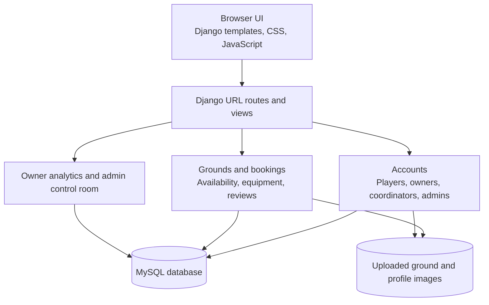

# GroundX

GroundX is a web platform for discovering and booking sports grounds. Players can search by city, sport, or ground, check live slot availability, and book a session. Ground owners manage their listings, schedules, equipment, and booking requests. Schools, colleges, and other institutions can request one-time events or recurring practice sessions.

## Features

- **Ground discovery** - Browse active grounds by city and sport, search by name, and find nearby listings using location coordinates.
- **Ground details and availability** - View venue details, photos, amenities, formats, reviews, equipment, and date-specific time slots.
- **Player bookings** - Reserve available slots, optionally rent equipment, review booking status, and manage eligible cancellations.
- **Owner workspace** - Add and edit grounds, set pricing and availability, manage equipment, respond to institution requests, and review bookings.
- **Owner approval** - Administrator approval controls which newly registered owners can publish and manage public listings.
- **Institution requests** - Coordinators can request grounds for one-time, daily, or weekly schedules. Owners can respond and confirm sessions when matching slots are available.
- **Reviews** - Players can leave a rating and review for a ground after a booking.
- **Analytics and administration** - Owners can view booking analytics. Administrators can review platform activity, approve owners, and manage owner fees.
- **Role-specific accounts** - Separate experiences for players, ground owners, institution coordinators, and administrators.

## Tech Stack

- **Backend:** Python, Django
- **Frontend:** Django templates, HTML, CSS, JavaScript
- **Database:** MySQL, connected through PyMySQL
- **Image uploads:** Pillow and Django media storage
- **Analytics:** Pandas and Matplotlib

## Architecture



## Local Setup

### Prerequisites

- Python version supported by Django 6.1.1
- MySQL server
- Git

### 1. Get the project

```bash
git clone https://github.com/gudashi-soham/GroundX.git
cd GroundX
```

### 2. Create and activate a virtual environment

Windows PowerShell:

```powershell
py -m venv .venv
.\.venv\Scripts\Activate.ps1
```

macOS or Linux:

```bash
python3 -m venv .venv
source .venv/bin/activate
```

### 3. Install dependencies

```bash
python -m pip install --upgrade pip
pip install -r requirements.txt
```

### 4. Create a MySQL database

In a MySQL client, create the database:

```sql
CREATE DATABASE smart_ground_db CHARACTER SET utf8mb4 COLLATE utf8mb4_unicode_ci;
```

The local defaults are `smart_ground_db`, user `root`, password `root`, host `127.0.0.1`, and port `3306`. Set environment variables to use your own MySQL credentials. For example, in PowerShell:

```powershell
$env:DB_NAME = "smart_ground_db"
$env:DB_USER = "root"
$env:DB_PASSWORD = "your_mysql_password"
$env:DB_HOST = "127.0.0.1"
$env:DB_PORT = "3306"
```

These commands set variables for the current terminal session. Set them again in a new session, or configure them in your operating system or deployment environment. The project does not load `.env` files automatically.

### 5. Apply migrations and create an administrator

```bash
python manage.py migrate
python manage.py createsuperuser
```

### 6. Start the development server

```bash
python manage.py runserver
```

Open [http://127.0.0.1:8000/](http://127.0.0.1:8000/) in your browser.

## Configuration

GroundX reads configuration from environment variables.

| Variable | Purpose | Default / requirement |
| --- | --- | --- |
| `DJANGO_DEBUG` | Enables Django debug mode when set to `true`, `1`, `yes`, or `on`. | `true` locally; set to `false` for deployment. |
| `DJANGO_SECRET_KEY` | Django signing and security key. | Development fallback is used only when debug mode is enabled; required when debug is disabled. |
| `DJANGO_ALLOWED_HOSTS` | Comma-separated hostnames accepted by Django. | `127.0.0.1,localhost`; required when debug is disabled. |
| `DB_NAME` | MySQL database name. | `smart_ground_db`; required when debug is disabled. |
| `DB_USER` | MySQL username. | `root`; required when debug is disabled. |
| `DB_PASSWORD` | MySQL password. | `root`; required when debug is disabled. |
| `DB_HOST` | MySQL server host. | `127.0.0.1` |
| `DB_PORT` | MySQL server port. | `3306` |
| `GOOGLE_MAPS_API_KEY` | Optional key read by settings for a Google Places integration. The default interface does not currently load the Places library. | Empty. |

For deployment, use a unique secret key, set `DJANGO_DEBUG=false`, and configure the database credentials and allowed hosts for your environment. Do not commit secrets to Git.

## Main Pages

| Page | URL |
| --- | --- |
| Ground discovery | `/` |
| Explore grounds | `/search/` |
| Ground details and booking | `/ground/<ground_id>/` |
| Player bookings | `/my-bookings/` |
| Owner dashboard | `/owner/dashboard/` |
| Owner analytics | `/analytics/owner/analytics/` |
| Institution information | `/institutions/` |
| Institution dashboard | `/institutions/dashboard/` |
| Administrator control room | `/control-room/` |
| Django administration | `/admin/` |

## Project Structure

```text
GroundX/
|-- accounts/                 # User roles, registration, and authentication
|-- analytics/                # Owner analytics and administrator control room
|-- grounds/                  # Grounds, availability, bookings, equipment, and reviews
|-- smart_ground_booking/     # Django settings and root URL configuration
|-- static/                   # CSS, JavaScript, and static images
|-- templates/                # Django HTML templates
|-- media/                    # Local uploaded images (not committed to Git)
|-- manage.py
|-- requirements.txt
`-- README.md
```


